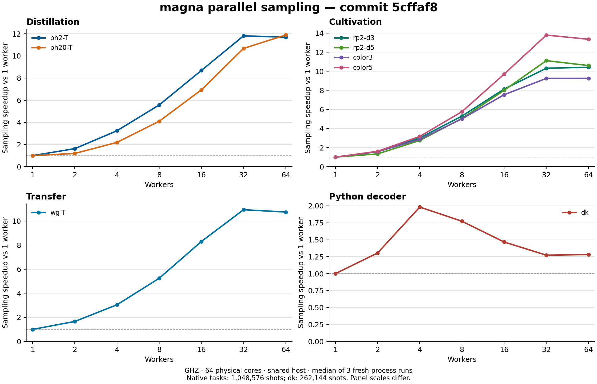

# Parallel sampling: merge preparation measurements

This report measures the existing public task interface at commit `5cffaf8`
on 2026-10-17. All eight requested tasks use the same production source and
native binary. No intermediate implementation or unmeasured optimization is
included. The results cover workers 1, 2, 4, 8, 16, 32, and 64 with three fresh
processes per configuration: 168 complete observations.

The subsequent [decoder callback follow-up](decoder-callback-benchmark.md)
profiles and reduces the Python adapter overhead, with fresh paired `dk`
measurements. The tables here retain the original pre-optimization results.

## Workloads and method

| Category | Task | Shots per observation |
|---|---|---:|
| Distillation | `bh2-T` | 1,048,576 |
| Distillation | `bh20-T` | 1,048,576 |
| Cultivation | `rp2-d3` | 1,048,576 |
| Cultivation | `rp2-d5` | 1,048,576 |
| Cultivation | `color3` | 1,048,576 |
| Cultivation | `color5` | 1,048,576 |
| Transfer | `wg-T` | 1,048,576 |
| Python decoder | `dk` | 262,144 |

Each task keeps its packaged physical-noise proposal, `affine_support` history
sampler, circuit, target, and resource settings. Only shots, seed, and workers
are overridden through `scripts/benchmark_parallel_sampling.py`, which invokes
`scripts/run_task.py` and public `magna.run`. No private sampling API is called.
The seeds are 20261017, 20261018, and 20261019. Within each task, the three
worker orders are 1/2/4/8/16/32/64, 64/32/16/8/4/2/1, and 8/32/2/64/4/16/1.
Task order rotates between repetitions. Three repetitions do not constitute
a fully balanced order design or a confidence interval.

The original four-task sweep completed before the additional cultivation and
decoder tasks ran. The additional tasks first ran separate 4,096-shot pilots
at 1 and 64 workers. The slower pilot selected a fixed power-of-two shot count
up to 1,048,576, targeting at most 40 seconds of extrapolated sampling time.
Pilot observations are excluded from all result tables. Shot counts never
change between workers or repetitions of the same task.

Sampling time includes first-use worker preparation, seeds, scheduling, exact
per-draw calculations, and ordered statistical accumulation. It excludes
initial task loading/preparation. CLI wall time also includes interpreter
startup, initial compilation, JSON output, and teardown. All tables show
medians of three observations; throughput is shots divided by median sampling
time, and speedup is the same task's 1-worker median divided by its N-worker
median. These are scaling ratios within this commit, not ratios against main.

## Hardware and operating conditions

| Item | Recorded environment |
|---|---|
| Host | `ghz` (`GHZ`) |
| CPU | 2 x Intel Xeon Platinum 8358P, nominal 2.60 GHz |
| CPU topology | 64 physical cores, 128 logical CPUs, SMT 2, 2 NUMA nodes |
| Process affinity | CPUs 0–63; one logical CPU per physical core |
| Memory visible to Linux | 503.51 GiB |
| Available memory during observations and pilots | 177.73–202.22 GiB |
| Host swap already in use / observed range | 6.27–6.27 GiB |
| Host swap activity over the monitored interval | 64 pages in; 0 pages out |
| One-minute load average | 72.80–79.07 |
| Aggregate CPU busy, interval min / median / max | 55.5% / 58.6% / 75.0% |
| OS | Linux-5.15.0-187-generic-x86_64-with-glibc2.35 |
| Python | Python 3.10.12 |
| Compiler | GCC 11.4.0; C++17, `-O3 -DNDEBUG -pthread` |
| Measurement interval, Asia/Shanghai | 2026-10-17 12:56:43 to 2026-10-17 13:26:54 |

This is a shared server, not an exclusive-core experiment. The same affinity
mask applies at every worker count; threads may migrate within that mask.
Other users may run on those CPUs or their SMT siblings. Affinity limits our
own SMT use but does not reserve cores. No other users' jobs were stopped or
reconfigured. Our benchmark processes ran sequentially, without another project
benchmark, native build, or regression suite running alongside them. Frequency
and NUMA memory policy were not changed by the harness.

Load average is distinct from CPU utilization. Available memory and swap
counters are host-wide observations, not this process's allocation. GNU time
measures each task process's individual peak RSS below. One-second host samples,
per-run loads, CPU time, context switches, and page faults are retained in the
evidence or source logs. No runs are selected or removed based on speed.

## Sampling throughput

Unit: **thousand shots per second**; higher is better.

| Task | Shots | 1 worker | 2 workers | 4 workers | 8 workers | 16 workers | 32 workers | 64 workers |
|---|---:|---:|---:|---:|---:|---:|---:|---:|
| `bh2-T` | 1,048,576 | 33.69 | 54.85 | 109.36 | 187.66 | 292.73 | 397.97 | 393.86 |
| `bh20-T` | 1,048,576 | 27.02 | 32.28 | 59.29 | 110.86 | 187.38 | 288.53 | 321.22 |
| `rp2-d3` | 1,048,576 | 42.91 | 67.40 | 129.29 | 227.47 | 349.17 | 442.79 | 447.12 |
| `rp2-d5` | 1,048,576 | 40.35 | 54.11 | 110.89 | 204.06 | 323.03 | 448.47 | 427.54 |
| `color3` | 1,048,576 | 45.71 | 71.90 | 130.97 | 229.27 | 344.70 | 423.04 | 422.94 |
| `color5` | 1,048,576 | 30.38 | 49.04 | 96.35 | 175.13 | 294.63 | 419.03 | 405.69 |
| `wg-T` | 1,048,576 | 38.98 | 64.68 | 118.69 | 204.39 | 323.43 | 426.24 | 418.73 |
| `dk` | 262,144 | 17.93 | 23.39 | 35.54 | 31.79 | 26.30 | 22.81 | 22.98 |

## Sampling speedup

Unit: **times the same task's one-worker throughput**.

| Task | 1 worker | 2 workers | 4 workers | 8 workers | 16 workers | 32 workers | 64 workers |
|---|---:|---:|---:|---:|---:|---:|---:|
| `bh2-T` | 1.00x | 1.63x | 3.25x | 5.57x | 8.69x | 11.81x | 11.69x |
| `bh20-T` | 1.00x | 1.19x | 2.19x | 4.10x | 6.93x | 10.68x | 11.89x |
| `rp2-d3` | 1.00x | 1.57x | 3.01x | 5.30x | 8.14x | 10.32x | 10.42x |
| `rp2-d5` | 1.00x | 1.34x | 2.75x | 5.06x | 8.01x | 11.12x | 10.60x |
| `color3` | 1.00x | 1.57x | 2.87x | 5.02x | 7.54x | 9.26x | 9.25x |
| `color5` | 1.00x | 1.61x | 3.17x | 5.76x | 9.70x | 13.79x | 13.35x |
| `wg-T` | 1.00x | 1.66x | 3.04x | 5.24x | 8.30x | 10.93x | 10.74x |
| `dk` | 1.00x | 1.30x | 1.98x | 1.77x | 1.47x | 1.27x | 1.28x |



| Task | Best measured worker count | Best speedup | 64-worker speedup |
|---|---:|---:|---:|
| `bh2-T` | 32 | 11.81x | 11.69x |
| `bh20-T` | 64 | 11.89x | 11.89x |
| `rp2-d3` | 64 | 10.42x | 10.42x |
| `rp2-d5` | 32 | 11.12x | 10.60x |
| `color3` | 32 | 9.26x | 9.25x |
| `color5` | 32 | 13.79x | 13.35x |
| `wg-T` | 32 | 10.93x | 10.74x |
| `dk` | 4 | 1.98x | 1.28x |

For the seven native-only tasks, the best observed speedups range from
9.26x to 13.79x. Moving from 32 to 64 workers changes
throughput by a factor of 0.95–1.11 across those tasks,
so this session does not show a doubling of throughput at the largest count.
The `dk` task peaks at 4 workers (1.98x),
compared with 1.28x at 64 workers.

These worker choices describe this workload and shared-host session only. They
are not universal defaults. More workers can lose to scheduling, serial seed
generation, ordered accumulation, and the cost of keeping multiple runtimes.
Different tasks use different shot counts, so compare worker ratios within a
row rather than treating absolute throughput across circuits as equal work.

The `dk` task invokes its bundled pure-Python Steane CSS decoder during terminal
recovery. Python callbacks acquire the interpreter lock; invocation order is
unspecified, while this decoder returns a deterministic result for its inputs.
Its row is included even when adding threads gives little benefit or makes it
slower. This is evidence for that complete task, not a measurement isolating the
GIL's exact cost. Reported decoder seconds sum worker intervals and can include
waiting for the GIL; they must not be read as a wall-time percentage.

## Sampling elapsed time and variability

Unit: seconds; lower is better.

| Task | Shots | 1 worker | 2 workers | 4 workers | 8 workers | 16 workers | 32 workers | 64 workers |
|---|---:|---:|---:|---:|---:|---:|---:|---:|
| `bh2-T` | 1,048,576 | 31.122 | 19.116 | 9.588 | 5.587 | 3.582 | 2.635 | 2.662 |
| `bh20-T` | 1,048,576 | 38.807 | 32.485 | 17.684 | 9.459 | 5.596 | 3.634 | 3.264 |
| `rp2-d3` | 1,048,576 | 24.435 | 15.556 | 8.110 | 4.610 | 3.003 | 2.368 | 2.345 |
| `rp2-d5` | 1,048,576 | 25.989 | 19.377 | 9.456 | 5.139 | 3.246 | 2.338 | 2.453 |
| `color3` | 1,048,576 | 22.941 | 14.584 | 8.006 | 4.574 | 3.042 | 2.479 | 2.479 |
| `color5` | 1,048,576 | 34.516 | 21.382 | 10.883 | 5.987 | 3.559 | 2.502 | 2.585 |
| `wg-T` | 1,048,576 | 26.900 | 16.211 | 8.835 | 5.130 | 3.242 | 2.460 | 2.504 |
| `dk` | 262,144 | 14.616 | 11.206 | 7.376 | 8.245 | 9.967 | 11.491 | 11.405 |

Observed minimum–maximum sampling seconds for selected counts:

| Task | 1 worker | 32 workers | 64 workers |
|---|---:|---:|---:|
| `bh2-T` | 16.834–31.140 | 2.606–2.992 | 2.580–2.903 |
| `bh20-T` | 34.756–61.733 | 3.546–3.741 | 3.210–3.416 |
| `rp2-d3` | 15.902–24.519 | 2.304–2.421 | 2.179–2.374 |
| `rp2-d5` | 21.046–30.967 | 2.274–2.389 | 2.339–2.537 |
| `color3` | 17.929–23.928 | 2.341–2.494 | 2.247–2.545 |
| `color5` | 28.137–35.996 | 2.407–2.513 | 2.547–2.747 |
| `wg-T` | 16.264–27.980 | 2.377–2.501 | 2.285–2.692 |
| `dk` | 14.512–14.802 | 11.397–11.528 | 11.230–11.618 |

Individual times for every count remain in the JSON. These ranges describe
three observations and are not statistical confidence intervals.

## Complete CLI wall time

Unit: seconds; includes startup, initial preparation, serialization, teardown.

| Task | 1 worker | 2 workers | 4 workers | 8 workers | 16 workers | 32 workers | 64 workers |
|---|---:|---:|---:|---:|---:|---:|---:|
| `bh2-T` | 31.258 | 19.254 | 9.730 | 5.740 | 3.717 | 2.779 | 2.827 |
| `bh20-T` | 39.111 | 32.741 | 17.886 | 9.773 | 5.875 | 3.922 | 3.575 |
| `rp2-d3` | 24.594 | 15.708 | 8.268 | 4.747 | 3.149 | 2.558 | 2.493 |
| `rp2-d5` | 26.219 | 19.601 | 9.671 | 5.376 | 3.488 | 2.587 | 2.744 |
| `color3` | 23.196 | 14.828 | 8.255 | 4.819 | 3.304 | 2.722 | 2.734 |
| `color5` | 34.750 | 21.530 | 11.095 | 6.206 | 3.797 | 2.712 | 2.836 |
| `wg-T` | 27.115 | 16.340 | 9.052 | 5.346 | 3.495 | 2.699 | 2.767 |
| `dk` | 14.768 | 11.376 | 7.544 | 8.400 | 10.138 | 11.650 | 11.580 |

## Peak resident memory

Unit: MiB; median of each process's peak RSS, observed by GNU time.

| Task | 1 worker | 2 workers | 4 workers | 8 workers | 16 workers | 32 workers | 64 workers |
|---|---:|---:|---:|---:|---:|---:|---:|
| `bh2-T` | 24.6 | 25.5 | 26.0 | 27.1 | 29.3 | 34.0 | 43.1 |
| `bh20-T` | 43.3 | 44.0 | 44.2 | 50.6 | 64.1 | 92.2 | 147.7 |
| `rp2-d3` | 25.3 | 26.6 | 27.0 | 28.7 | 31.9 | 38.6 | 51.7 |
| `rp2-d5` | 33.3 | 34.0 | 34.7 | 38.8 | 47.4 | 64.3 | 97.9 |
| `color3` | 25.0 | 25.7 | 26.6 | 28.3 | 31.4 | 38.3 | 51.5 |
| `color5` | 32.9 | 33.9 | 34.9 | 39.2 | 48.2 | 65.8 | 101.0 |
| `wg-T` | 32.3 | 33.2 | 34.1 | 38.8 | 48.0 | 66.3 | 103.3 |
| `dk` | 26.1 | 26.7 | 27.4 | 29.5 | 33.0 | 40.3 | 55.2 |

## Consistency and provenance

All 168 observations completed the requested shots. For each task and seed,
the complete results at workers 2, 4, 8, 16, 32, and 64 agree exactly after
excluding only timings, diagnostic resources, and the requested worker count.
This gives 120 exact comparisons across 25 result fields. Native query
counts also match across parallel worker counts. Serial and parallel random
streams intentionally differ; serial outputs are retained separately and are
not claimed to match parallel draws. The smaller shot counts used for slow
tasks measure runtime, not the precision of a scientific estimate.

The Python import paths, native binary hash, all 97 native source hashes, all
production-source inputs, and the eight task directories were checked against
the local checkout before their measurements. The production source SHA-256 is
`af020c92f512b9781a012f440f9d73a4ad55907996074530192c5e7d2c0dc0f7`. The native binary SHA-256 is
`1bb8a57d1487853177db4f1eea8031a159b5ba7dda10866b413a74f915aa98e9`. The snapshot uses the already tested
release build; this reporting work makes no production-code change.

The [machine-readable evidence](benchmark-results/parallel-sampling-merge-20261017.json)
contains all 168 timings, scientific result hashes and representative payloads,
the equality checks, memory observations, environment, and exact commands.
Original driver outputs, pilot results, telemetry, and logs remain under
`/tmp/magna-merge-benchmark-20261017` on ghz. The earlier
[shared-plan report](shared-plan-sampling-benchmark.md) documents the 379-test
regression run and UBSan validation; those historical performance measurements
are not mixed into these tables.

## Reproduction

Build this commit normally, then run the existing driver. For example:

```bash
PYTHONPATH=core:. taskset -c 0-63 python3 scripts/benchmark_parallel_sampling.py \
  examples/bh2-T examples/bh20-T examples/rp2-d3 examples/wg-T \
  --workers 1 2 4 8 16 32 64 --shots 1048576 --repeats 3 \
  --seed 20261017 --label merge-preparation --output scaling.json
```

Use each additional task's shot count from the workload table. On a different
machine, select an appropriate CPU mask from its actual topology. The exact
recorded three worker orders and rotated task orders are in the evidence;
the short command above uses the existing driver's standard rotation instead.
All timing processes explicitly set `PYTHONPATH` to their chosen source snapshot
to prevent importing an unrelated installed package.
